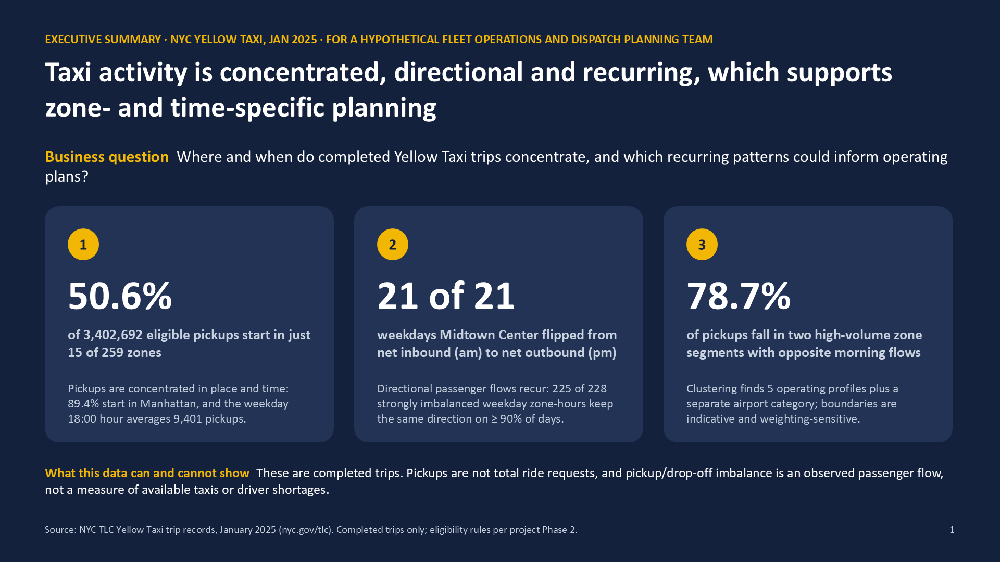

# NYC Yellow Taxi: Where and When Trips Concentrate

An end-to-end analysis of 3.48 million NYC Yellow Taxi trip records from January
2025. It covers data cleaning, exploratory analysis, pickup/drop-off flow
metrics, mix-adjusted fare comparisons and k-means zone segmentation, and ends
with a five-slide executive deck. Everything is reproducible from the official
TLC data with one ordered set of commands.

**Status:** complete. All five stages run end to end, and a fresh-clone
reproduction regenerates the same outputs.



## Business context

**Intended audience:** a hypothetical NYC Yellow Taxi fleet operations or
dispatch planning team that wants to plan staffing, staging and vehicle
positioning by zone and time of day.

**Business questions**

1. Where and when do completed Yellow Taxi pickups concentrate?
2. Which zones send out more trips than they receive (or the reverse), and do
   those passenger-flow patterns recur from day to day?
3. Do fares differ between the evening rush and midday once trip length and
   duration are held constant?
4. Can zones be grouped into a small number of operating profiles that are
   stable enough to plan with?

**What the data can't answer.** The records cover completed trips only. They
don't show ride requests that went unserved, where vacant taxis were, or
waiting times. Pickups are therefore a lower bound on demand, and
pickup/drop-off imbalance describes passenger flow, not taxi supply or driver
shortages. Metered Yellow Taxi fares follow regulated rates, so fare
differences can't be read as surge pricing.

## Key findings

All figures are for January 2025 and use the eligibility rules described
below. Each one is recomputed from the data when the deck is built.

1. **Pickups are highly concentrated.** 89.4% of the 3,402,692 eligible
   pickups start in Manhattan, and 15 of 259 active zones account for 50.6%.
   Weekday pickups peak at 18:00, averaging 9,401 per day, compared with 5,738
   at 08:00.
2. **Directional passenger flows recur.** Midtown Center received more trips
   than it sent in every hour from 07:00 to 09:59 and sent more than it
   received in every hour from 17:00 to 21:59, on all 21 non-holiday
   weekdays. Citywide, 225 of 228 strongly imbalanced weekday zone-hours kept
   the same direction on at least 90% of days. These cells were selected for
   strong imbalance first, so high persistence is partly expected.
3. **The evening fare difference comes from a scheduled surcharge.** For
   standard-rate metered trips at the same distance and duration, the
   metered base fare in the 16:00 to 19:59 weekday rush is 1.1% *lower* than
   at midday. The total charge excluding tips is 11.2% higher, which is
   consistent with the published $2.50 weekday rush-hour surcharge.
4. **Flex Fare growth shifts the fare sample.** App-booked Flex Fare trips
   rose from 4 to 5% of daily pickups on 2 to 6 January to mostly 11 to 24%
   per day from 8 January. Their
   fare fields are incomplete, so they are analysed separately, and the
   metered fare sample changes composition over the month.
5. **Two high-volume segments carry most activity.** K-means on 101 zones
   found two high-volume segments with opposite morning flows that together
   hold 78.7% of all eligible pickups. The five-segment solution is an
   analyst choice: the pre-specified selection rule picked k = 2, and 20 of
   101 zones change segment under an alternative feature weighting.

## Executive deck

[`reports/nyc_taxi_executive_deck.pptx`](reports/nyc_taxi_executive_deck.pptx)
has five slides with native, editable charts: an executive summary, demand
concentration and fares, recurring directional flows, zone segmentation, and
recommendations with the data needed to validate each one. PNG previews are in
[`reports/deck_preview/`](reports/deck_preview/).

The recommendations are framed as pilots and studies to validate. No
reduction in waiting times, revenue gain or utilisation improvement is
claimed.

## Methodology

| Stage | What it does | Details |
|---|---|---|
| 1. Acquisition and profiling | Downloads the official files, records SHA-256 checksums and profiles schema, nulls and coverage | [phase1_data_profile.md](reports/phase1_data_profile.md), [data_sources.md](docs/data_sources.md) |
| 2. Cleaning | Flags rows instead of deleting them. 17 documented flags with reason codes (8 data-quality, 5 analytical-scope, 4 informational) keep data problems separate from scope exclusions, and four eligibility flags (demand, distance and duration, fare, clustering) select rows per analysis. Negative-fare reversals are matched one to one | [cleaning_rules.md](docs/cleaning_rules.md), [phase2_quality_report.md](reports/phase2_quality_report.md) |
| 3. Exploratory analysis | Pickups by hour, day type and zone with explicit denominators. Drop-offs are validated independently of pickups. Imbalance index (P − D)/(P + D) with a minimum-volume rule, day-level persistence, and fares direct-standardised to a common distance × duration mix | [eda_metrics.md](docs/eda_metrics.md), [phase3_eda_report.md](reports/phase3_eda_report.md) |
| 4. Zone segmentation | K-means on eight standardised operational features for zones with ≥ 1,000 pickups, airports held out. Pre-registered k-selection rule, day-resampling and seed stability (ARI), feature-weighting sensitivity and rule-based baselines | [clustering_design.md](docs/clustering_design.md), [phase4_clustering_report.md](reports/phase4_clustering_report.md) |
| 5. Executive deck | Builds the deck with python-pptx and refuses to write it if any displayed number differs from the analysis outputs | [build_deck.py](src/build_deck.py) |

The exploratory report labels each result as observed, implication or
hypothesis, and every report states its denominators and exclusions.

## Tech stack and skills

- **Python 3.12:** pandas and PyArrow (column-subset, memory-aware processing
  of a 3.5M-row Parquet file on a laptop with about 2 GB free RAM),
  scikit-learn (k-means, silhouette, ARI), matplotlib, python-pptx and pytest.
- **Skills shown:** data-quality auditing, rule-based cleaning with audit
  trails, metric design with explicit denominators, direct standardisation,
  unsupervised learning with stability and sensitivity checks, reproducible
  pipelines, automated testing and executive communication of uncertain
  results.

## Reproduce the analysis

Requires Windows, macOS or Linux with Python 3.12 (tested with 3.12.10 on
Windows 11; Python 3.13 and 3.14 are untested), about 1 GB of disk including
the virtual environment, and about 2 GB of free RAM.

```powershell
# 1. Environment (PowerShell; on macOS/Linux use python3.12 and source .venv/bin/activate)
py -3.12 -m venv .venv
.\.venv\Scripts\Activate.ps1
python -m pip install -r requirements.txt -c requirements-lock.txt

# 2. Pipeline, in this order
python src/download_data.py      # official TLC files -> data/raw/, checked against manifest.json
python src/profile_raw.py        # raw data profile -> reports/phase1_data_profile.*
python src/clean_trips.py        # flags and eligibility -> data/processed/..._flagged.parquet
python src/validate_cleaned.py   # integrity checks -> reports/phase2_quality_report.*
python src/eda_aggregates.py     # aggregate tables -> data/processed/eda/
python src/eda_figures.py        # charts fig01-fig09 -> reports/figures/
python src/zone_features.py      # zone tables and features -> data/processed/zones/
python src/zone_clustering.py    # k-means selection, stability, sensitivity
python src/cluster_figures.py    # charts fig10-fig15 -> reports/figures/
python src/build_deck.py         # verified numbers -> reports/nyc_taxi_executive_deck.pptx

# 3. Tests
python -m pytest -q
```

A fresh clone took about 2.5 minutes on a Ryzen 7 laptop, with a peak of
about 1.6 GB of memory (in `eda_aggregates.py`). It regenerated all 51
processed tables and all 15 charts byte for byte, and the generated reports
with identical content.

**Notes**

- `requirements.txt` lists the direct dependencies, and
  `requirements-lock.txt` pins every package used to produce the committed
  results.
- If TLC republishes the January 2025 file, `download_data.py` reports
  `CHANGED` and stops instead of accepting the new file. See
  [docs/data_sources.md](docs/data_sources.md#if-a-checksum-changes).
- Rebuilt decks differ from the committed file only in metadata timestamps
  (document properties and the embedded chart workbooks). Slide content is
  identical.
- The slide previews in `reports/deck_preview/` were exported with Microsoft
  PowerPoint on Windows. No script in this repository produces them, and
  `build_deck.py` does not need PowerPoint.

## Repository structure

```
data/raw/             Official TLC files (gitignored); manifest.json with checksums is tracked
data/processed/       Flagged trips and aggregate tables (gitignored, regenerated by the pipeline)
docs/                 Data sources, cleaning rules, metric definitions, clustering design
reports/              Stage reports, executive deck, slide previews
reports/figures/      Charts fig01-fig15
src/                  Pipeline scripts, one per step above
tests/                pytest unit tests and an end-to-end test on synthetic trips
requirements.txt      Direct dependencies
requirements-lock.txt Full pinned environment
```

## Data sources and attribution

Trip records, the taxi zone lookup and the data dictionary come from the
[NYC Taxi & Limousine Commission trip record data](https://www.nyc.gov/site/tlc/about/tlc-trip-record-data.page).
The data isn't included in this repository; the download script fetches it
from TLC. This is an independent project, not affiliated with or endorsed by
TLC or the City of New York.

## Limitations

- **One month.** January includes two holidays, a slow first week and fast
  Flex Fare growth. Patterns may differ in other months.
- **Completed trips only.** There's no data on unserved requests, vacant-taxi
  locations or waiting times, so demand, supply and service-level claims
  aren't possible.
- **Persistence is measured on selected cells.** Strongly imbalanced cells
  were chosen and evaluated within the same month.
- **The segmentation is indicative.** k = 5 was chosen by the analyst rather
  than by the pre-specified rule, membership shifts with feature weighting
  (72.4% of pickups keep their segment), and the segments haven't been tested
  against any business outcome.
- **Fare analysis covers metered standard-rate trips.** Flex Fare records
  have incomplete fare fields, and their growing share changes the
  composition of the fare sample.
- **Some data conventions are inferred.** The VendorID 1 fee treatment and the
  meaning of negative-fare records are inferred from patterns, not from TLC
  documentation.

## License

The original project code, tests and documentation are released under the
[MIT License](LICENSE), copyright (c) 2026 Delphino Chew Jing Cheng.

The MIT License applies only to this project's original work. It grants no
rights to third-party data or software:

- **NYC TLC data:** the trip records, taxi zone lookup and data dictionary are
  published by the NYC Taxi & Limousine Commission and are subject to TLC and
  NYC Open Data terms of use. They aren't included in this repository; the
  download script fetches them from TLC. The figures, tables and deck in
  `reports/` are derived from that data.
- **Python packages:** the dependencies in `requirements.txt` are installed
  separately and remain under their own licenses.
